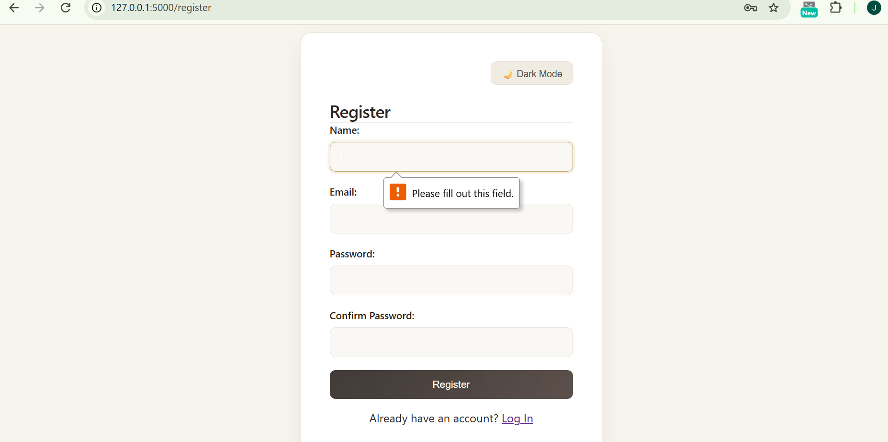
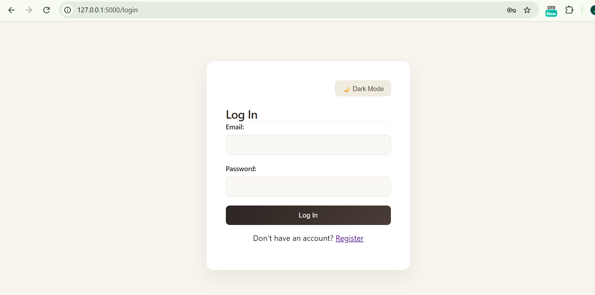
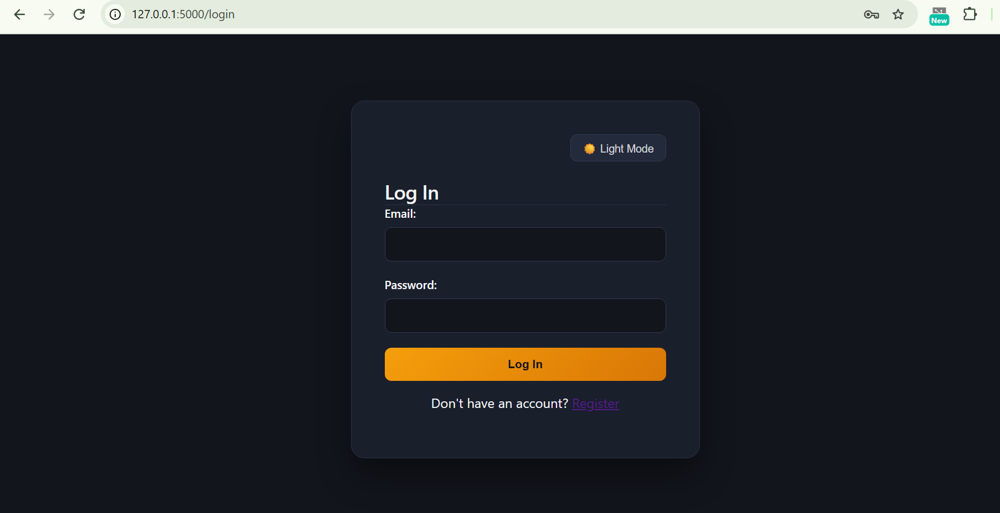
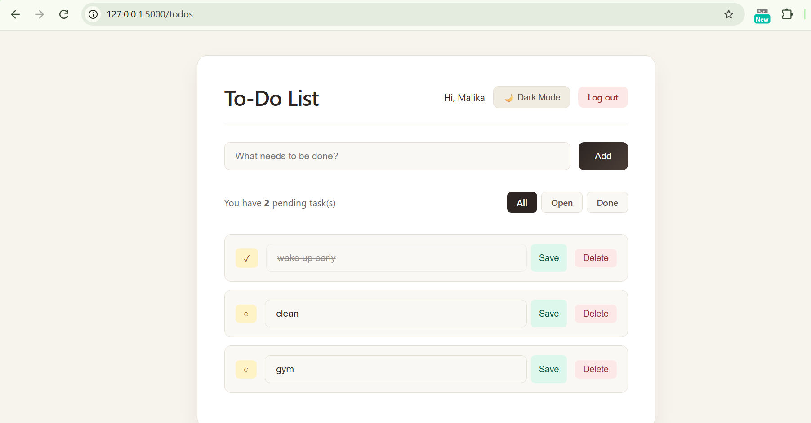
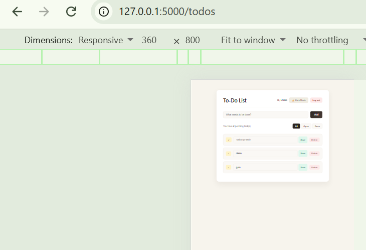

# Database Lab 2 - Flask To-Do Application

A secure multi-user To-Do web application built with **Flask**, **MySQL**, and **Bootstrap/CSS**. This project implements user authentication, session management, secure CRUD operations, proper database constraints, and custom bonus features.

---

## 👥 Team & Contributions ("Who Did What")
- **Jana Alaa (ID: 2304024):** Developed the backend authentication routes, implemented database connection logic, wrote the core Flask application routes, and handled GitHub repository setup.
- **Salma (ID: 2304018):** Designed the database schema (`schema.sql`), built the frontend HTML templates, styled the user interface, and tested user workflows.
- **Group / Section:** Group 2, Section 4

---

## 🚀 Key Features
- **User Authentication:** Secure registration and login with password hashing.
- **Data Isolation:** Logged-in users can only view, update, and delete their own personal tasks.
- **Input Validation:** Prevents empty or whitespace-only task entries.
- **Relational Integrity:** Foreign key constraints linking tasks securely to users.

---

## ⭐ Extra Bonus Features Implemented
- **Live Pending Task Counter:** Dynamically calculates and displays the exact number of remaining open tasks in real-time.
- **Task Filtering System:** Allows users to easily switch between viewing **All**, **Open**, or **Done** tasks using query parameters.
- **Dark / Light Mode Toggle:** An interactive JavaScript-powered theme switcher for a customizable visual experience.
- **Mobile Responsiveness:** Fully adaptive UI layout tested down to a 360px mobile viewport width.

---

## 💻 How to Run the Project Locally

1. **Clone the repository:**
   ```bash
   git clone [https://github.com/janaalaa741078-bot/db-lab2.git](https://github.com/janaalaa741078-bot/db-lab2.git)
   cd db-lab2

   Lab Theoretical Questions & Answers
**Q1: Why do UPDATE and DELETE contain AND user_id = ?, and what changes if you remove it?**
**Answer:** We add AND user_id = ? so that a user can only touch their own tasks. If you remove it, anyone logged into the app could modify or delete other people's tasks just by changing the task ID in the request or URL, which creates a huge security hole (IDOR vulnerability).

**Q2: What happens if you insert a to-do for a user_id that does not exist, and which constraint is that?**
**Answer:** The database will throw an Integrity Error and refuse to add it. This happens because of the Foreign Key constraint (FOREIGN KEY (user_id) REFERENCES users(id)), which makes sure we don't end up with orphaned tasks belonging to users that aren't in the database.

**Q3: Why do you store a hash and not the plain-text password?**
**Answer:** Because if the database ever gets hacked or leaked, plain-text passwords would expose every user. Storing a secure hash (like bcrypt) means passwords are scrambled into unreadable strings, so even if someone sees the database, they can't steal the actual passwords.

**Q4: The name column is NOT NULL: did you still need your own check for an empty name?**
**Answer:** Yes, absolutely. Even though the database stops NULL values, it will happily accept an empty string ("") or a bunch of spaces ("   "). We still need code-level validation to catch those empty inputs and give the user a proper warning.


    

